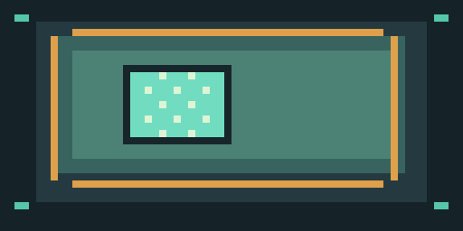
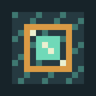
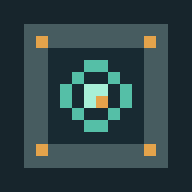
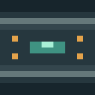
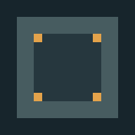

# Drone Artisan

**Un mod de drones compagnons pilotables pour Minecraft Java 1.21.1 et NeoForge.** Déploie ton drone, donne-lui des ordres depuis sa base ou prends directement les commandes. Projet indépendant, encore en développement.

[](https://www.minecraft.net/)
[](https://neoforged.net/)
[](https://adoptium.net/)

**Ton avis compte :** [ouvre une discussion ou signale un problème sur GitHub](https://github.com/NoS2747/Drone-Artisan/issues/new). Les retours souhaités : lisibilité des interfaces, maniabilité, collisions, idées de commandes ou bugs rencontrés.

## Textures du mod

Les aperçus ci-dessous montrent les textures pixel-art incluses dans le mod.

| Drone | Télécommande |
|---|---|
|  |  |

| Dessus de la base | Côté de la base | Dessous de la base |
|---|---|---|
|  |  |  |

## Fonctionnalités

- Drone personnel avec **20 cœurs**, batterie, inventaire de soute et sauvegarde des données.
- Pilotage à la première personne : vol directionnel avec collisions contre les blocs, accélération, caméra embarquée et commandes clavier configurables.
- Actions manuelles : miner un bloc ciblé avec l'outil du joueur, utiliser les objets sur blocs et entités, poser un bloc de la soute sans remplacer ni détruire le bloc visé.
- Laser contre les monstres hostiles : **3 cœurs** de dégâts.
- Ordres automatisés : suivre, rester, ramasser des objets, récolter des cultures mûres, miner certains minerais, localiser les minerais, défendre le propriétaire et retourner à la base.
- Base servant de point de liaison et de recharge, console dédiée et télécommande.
- Interfaces et traductions en français et en anglais.

Les actions de minage, placement et interaction sont vérifiées côté serveur et respectent les permissions et règles de jeu applicables. Le pilotage ne permet pas de traverser les blocs. Le minage manuel ne casse pas les blocs avec entité de bloc.

## Installation

1. Installer **Minecraft Java 1.21.1** avec **NeoForge 21.1.256**.
2. Télécharger `droneartisan-1.0.0.jar` depuis la section [Releases](https://github.com/NoS2747/Drone-Artisan/releases).
3. Placer le fichier dans le dossier `mods` de l'instance Minecraft.
4. Lancer le jeu avec NeoForge.

## Compiler et tester

Prérequis : JDK 21. Depuis la racine du dépôt :

```powershell
.\gradlew.bat clean test build
```

Le JAR est produit dans `build\libs\droneartisan-1.0.0.jar`.

## Jouer

Fabrique un **kit de drone** et fais un clic droit sur le sol pour déployer ton drone personnel. Fabrique une **télécommande** : un clic droit dans l'air ouvre sa console portable; un clic droit sur le drone ouvre sa console. Un clic droit à main nue sur le drone ouvre l'interface embarquée.

Les consoles affichent la batterie, l'intégrité, les neuf emplacements de soute et les ordres disponibles. Le drone accepte des blocs dans sa soute : fais un clic droit dessus avec un bloc en main. À main nue, tu peux reprendre un objet. Un lingot de fer répare le drone; de la redstone recharge sa batterie.

Fabrique et place la **Base de drone**, puis fais un clic droit à main nue pour la lier au drone chargé le plus proche (jusqu'à 64 blocs). Seul son propriétaire peut utiliser sa console. Le drone recharge lentement sa batterie lorsqu'il stationne près de sa base.

### Pilotage

Utilise **Piloter le drone** dans la console :

| Commande | Action |
|---|---|
| WASD | Voler dans la direction de la caméra |
| Espace / Maj | Monter / descendre |
| Touche Sprint (Ctrl par défaut) | Accélérer |
| Clic gauche maintenu sur un bloc | Miner avec l'outil du joueur |
| Clic droit sur un bloc ou une entité | Utiliser l'objet tenu |
| Clic droit sur un bloc avec face libre | Poser un bloc de la soute |
| G | Tirer le laser |
| V | Terminer le pilotage |

Les touches **G** et **V** sont configurables dans *Options → Commandes*. Le drone utilise l'outil tenu par le joueur; si la télécommande occupe sa main, il cherche un outil adapté dans l'inventaire. Les outils perdent leur durabilité normalement. Le laser inflige 3 cœurs aux monstres hostiles et consomme de la batterie.

## Recettes

La base :

```text
 i r i
c  R  c
I  I  I
```

`i` lingot de fer, `r` redstone, `c` lingot de cuivre, `R` comparateur, `I` bloc de fer.

Les recettes du kit de drone et de la télécommande sont disponibles dans le livre de recettes du jeu.

## Limites actuelles

Le mod est en développement. Le minage automatisé est restreint aux blocs du tag `droneartisan:drone_mineable`; le déplacement peut être gêné par des espaces étroits; les interfaces de blocs qui exigent la présence physique du joueur ne sont pas transférées à la caméra du drone. Réseau d'antennes, améliorations modulaires, réparation de blocs et construction automatisée planifiée ne sont pas encore implémentés.

## Donner son avis

Les retours sont les bienvenus, même si tu n'as fait qu'essayer les textures ou regarder les captures du projet. [Créer un retour sur GitHub](https://github.com/NoS2747/Drone-Artisan/issues/new) en indiquant si possible ta version de Minecraft/NeoForge, les étapes pour reproduire un bug et ce que tu aimerais voir ensuite.

---

**English**

Drone Artisan is an independently developed companion-drone mod for **Minecraft Java 1.21.1**, **NeoForge 21.1.256**, and **Java 21**. Deploy a personal drone, send it orders from its base, or pilot it directly. It features a 20-heart drone, battery and cargo, first-person manual flight with block collisions, tool-based mining, item interactions, safe block placement, a 3-heart laser, task automation, a control base, a remote, and French/English translations.

The mod is still in development. Automated mining is limited to the `droneartisan:drone_mineable` tag; tight spaces can impede movement, and block interfaces that require the player to be physically nearby do not move to the drone camera. Antenna networks, modular upgrades, block repair, and planned automated construction are not implemented yet.

**We'd love your feedback!** Please [open a GitHub issue](https://github.com/NoS2747/Drone-Artisan/issues/new) with bugs, UI or flight-control feedback, and feature ideas.

Install Minecraft 1.21.1 with NeoForge 21.1.256, download the mod JAR from [Releases](https://github.com/NoS2747/Drone-Artisan/releases), and place it in your instance's `mods` folder. Build and run tests with JDK 21 using `.\gradlew.bat clean test build`.
